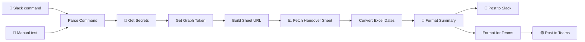

<div align="center">

# 🔁 ShiftRelay

**One Slack command turns a SharePoint handover sheet into a shift summary posted to Slack and Microsoft Teams.**


</div>

---

## The scenario

**Acme** is a managed SOC client. During each shift, analysts log every alert in a shared Excel workbook on SharePoint. When the shift ends, the outgoing analyst types:

```
acme_handover 2026-03-17 evening
```

ShiftRelay reads Acme's sheet, builds the summary and delivers it to both channels:

| Destination | Receives | Format |
|---|---|---|
| 💬 Slack `#acme-soc` | Alert details, SOC analysis summary, **shift handover** with the next shift's group tagged | Slack mrkdwn, split into chunks under 3,900 characters |
| 🟣 Microsoft Teams | Alert details and SOC analysis summary (**no internal handover**) | One HTML message posted through Power Automate |

Slack is the SOC team's working channel, so it gets the handover notes. Teams is client-facing, so the internal handover section is removed automatically.

## How it works



| # | Node | What it does |
|---|------|--------------|
| 1 | Slack Trigger | Listens in the command channel |
| 2 | Parse Command | Validates `acme_handover YYYY-MM-DD [shift]` (shift defaults to evening) and ignores other messages |
| 3 | Get Secrets | Runs a secrets sub-workflow, so no secrets are stored in this workflow |
| 4 | Parse Secrets | Extracts the SharePoint app secret |
| 5 | Get Graph Token | OAuth2 client-credentials token for Microsoft Graph |
| 6 | Build Sheet URL | Graph URL for `Handover_Sheet!A1:Q200` in Acme's workbook |
| 7 | Fetch Handover Sheet | Reads the range through Graph |
| 8 | Convert Excel Dates | Converts Excel serial dates to `YYYY-MM-DD` |
| 9 | Format Summary | Filters to the date and shift, dedupes alerts, groups by data source, counts severity, true positives and pending items, and tags the next shift |
| 10 | Post to Slack | Posts each chunk to `#acme-soc` |
| 11 | Format for Teams | Converts Slack markup to HTML, removes the handover section, checks the ~28 KB Teams limit |
| 12 | Post to Teams | Sends `{subject, html}` to a Power Automate flow |

## Setup

### Prerequisites

- n8n with Code nodes enabled
- A Slack app in the command channel and `#acme-soc`, with `channels:history` and `chat:write`
- An Entra ID app registration with Graph **`Sites.Read.All`** (application permission, admin-consented)
- Acme's handover workbook in SharePoint, with a `Handover_Sheet` tab
- Power Automate access to the target Teams channel

### 1. Secrets sub-workflow

Create a small n8n workflow that returns the following (from a vault, env vars, etc.), then put its ID in **Get Secrets**:

```json
{ "sharepoint": { "client_secret": "…" } }
```

### 2. Teams flow (Power Automate)

1. New flow → trigger: **When an HTTP request is received**, with this body schema:
   ```json
   { "type": "object", "properties": { "subject": {"type": "string"}, "html": {"type": "string"} } }
   ```
2. Action: **Post message in a chat or channel** → choose the channel, set Subject = `subject` and Message = `html`.
3. Save, then copy the generated HTTP POST URL.

### 3. Import and fill placeholders

Import `shiftrelay-workflow.json`, then replace:

| Placeholder | Node | Replace with |
|---|---|---|
| `YOUR_COMMAND_CHANNEL_ID` | Slack Trigger | Command channel ID |
| `YOUR_SECRETS_SUBWORKFLOW_ID` | Get Secrets | Secrets workflow ID |
| `YOUR_TENANT_ID` | Get Graph Token | Entra ID tenant ID |
| `YOUR_SHAREPOINT_APP_CLIENT_ID` | Get Graph Token | App (client) ID |
| `yourtenant.sharepoint.com`, `YOUR_SITE_COLLECTION_ID`, `YOUR_SITE_ID`, `YOUR_DRIVE_ID` | Build Sheet URL | Your SharePoint site and drive |
| `YOUR_WORKBOOK_ITEM_ID` | Build Sheet URL | Acme's workbook item ID |
| `acme-soc` | Post to Slack | Client Slack channel |
| `YOUR_GROUP_ID` (×3) | Format Summary | Morning, evening and night shift user-group IDs |
| `https://YOUR_POWER_AUTOMATE_FLOW_URL` | Post to Teams | URL from step 2 |

Then assign your Slack credential to **Slack Trigger** and **Post to Slack**.

### 4. Test

Click **Manual Trigger (Test)**. It simulates `acme_handover 2026-03-17 evening` without Slack. Once both posts look right, activate the workflow.

## Customising

| Want to… | Change |
|---|---|
| Rename the client / command | `COMMAND` in **Parse Command**, channel in **Post to Slack** |
| Change shift end times | `shiftEndTimes` in **Format Summary** |
| Show the handover in Teams too | Remove the `handoverIdx` filter in **Format for Teams** |
| Handle more rows | `range` in **Build Sheet URL** (default `A1:Q200`) |
| Add more clients | Duplicate nodes 6–12 per client and add a Switch after **Get Graph Token** |

## Security

This export has been redacted. It contains no tokens, secrets, tenant, site or workbook IDs, channel IDs, email addresses or real client names. Never commit a live n8n export. If a token was ever hardcoded in an exported workflow, rotate it.

## License

[MIT](LICENSE) © 2026 Rana Talha
